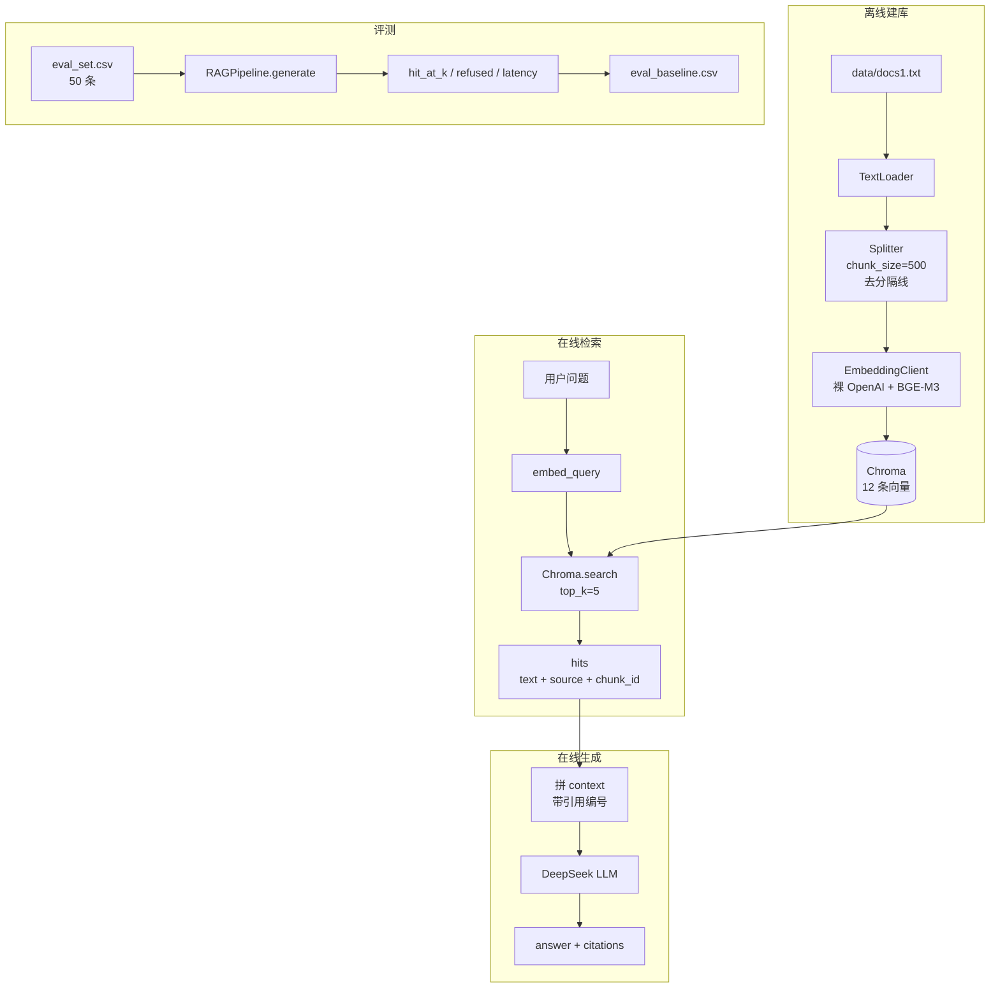

# RAG 客服 Agent

基于 LangChain + Chroma + BGE-M3 + DeepSeek 的 RAG 客服问答系统，支持引用追溯、拒答判断和可复现评测。

## 快速开始

```bash
pip install -r requirements.txt
cp .env.example .env        # 填 SILICONFLOW_API_KEY / DEEPSEEK_API_KEY
python ingest.py            # 建库 + 导出 chunk_map.csv
python evaluate.py          # 跑 50 条评测，生成 eval_baseline.csv
```

## 架构



## 评测结果（50 条）

| 类别 | 条数 | Hit@K | 拒答准确率 |
|---|---|---|---|
| simple | 20 | 1.00 | 1.00 |
| multi_hop | 15 | 1.00 | 1.00 |
| no_answer | 10 | N/A | 0.90 |
| ambiguous | 5 | 1.00 | 1.00 |
| 时延 | — | avg 1475ms | p95 2275ms |

## 关键 debug 过程

| 版本 | 改动 | simple Hit@K |
|---|---|---|
| v1 | chunk_size=220 + 章节分隔符 | 0.05 |
| v2 | chunk_size=500 + 去分隔线 | 0.40 |
| v3 | OpenAIEmbeddings → 裸 OpenAI 客户端 | **1.00** |

**v1 根因**：`====` 分隔线把章节标题切成独立 chunk，纯标题碎片占满 top-5，模型拿不到答案。

**v2 根因**：检索排序随机，所有 score 挤在 0.20—0.29，chunk 1 排第 9。

**v3 根因**：`OpenAIEmbeddings` 的 `openai:` 前缀没去掉 + `check_embedding_ctx_length=True` 把中文 tiktoken 化，向量和 SDK 直调不一致（0.35 vs 0.78）。换裸 `OpenAI` 客户端后一致。

## Badcase 记录

完整记录见 [docs/badcase.md](docs/badcase.md)，摘要 2 条：

| 编号 | 类型 | 现象 | 根因 | 状态 |
|---|---|---|---|---|
| BC-003 | Embedding 失效 | 所有 chunk score 挤在 0.20—0.29，相关/不相关相似度都是 0.2995 | `OpenAIEmbeddings` 的 `openai:` 前缀没去掉 + `check_embedding_ctx_length=True` 把中文 tiktoken 化 | 🟢 已修复 |
| BC-004 | 排序偏差 | chunk 10（私有化部署）排第 1，chunk 1（基础版套餐）排第 2 | BGE-M3 对短 query 有语义噪声，纯向量检索不做关键词精确匹配 | 🟡 待加 reranker |

**BC-003 是这次 debug 最关键的发现**：SDK 直调相关相似度 0.78，`OpenAIEmbeddings` 只有 0.35，换裸 `OpenAI` 客户端后一致。

## 目录结构

```text
├── ingest.py            # 离线建库
├── evaluate.py          # 批量评测
├── src/
│   ├── config.py        # 配置加载
│   ├── embed_model.py   # EmbeddingClient（裸 OpenAI）
│   ├── vector_store.py  # Chroma 封装
│   ├── splitter.py      # 切分（去分隔线）
│   ├── llm.py           # LLM 工厂
│   └── rag_pipeline.py  # ingest / retrieve / generate
├── data/
│   ├── docs1.txt
│   └── eval_set.csv     # 50 条评测集
├── results/
│   ├── chunk_map.csv
│   ├── eval_baseline.csv
│   └── eval_baseline_broken.csv   # 修复前，Hit@K=0.05
└── docs/
    ├── architecture.md
    └── badcase.md
```

## 已知问题

- `no_answer` id=44：模型对“专业版私有模型路由”做了推断，未拒答。这是 RAG “列表缺失 ≠ 不支持”的典型边界。
- 时延 p95=2275ms，后续可考虑降 top_k 或加缓存。
- 未加 reranker，纯向量检索对短 query 有语义噪声（chunk 10 曾排第 1）。

## 下一步

- [ ] 加 `bge-reranker-v2-m3`，做 `eval_rerank.csv` 对比
- [ ] 多模型对比（DeepSeek vs 百炼 vs SiliconFlow）
- [ ] Streamlit UI